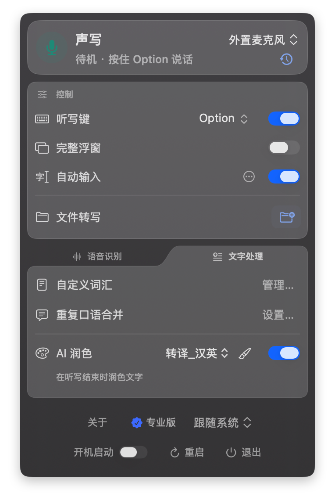
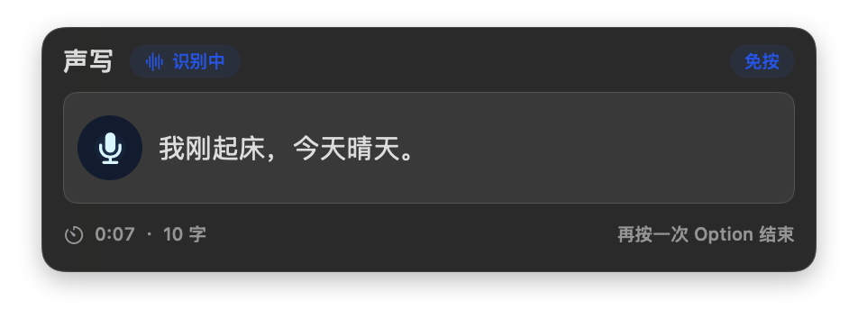
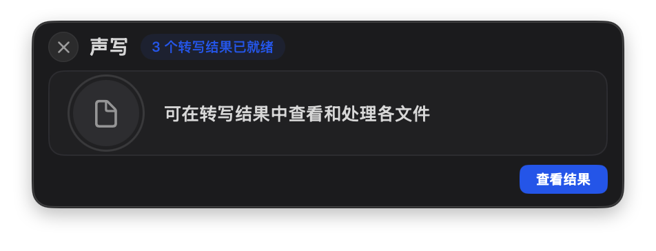

# 声写 SVoxa

**在 Mac 上，把想说的话变成文字。**

给 AI 描述复杂需求、写邮件、整理文章提纲——先把想法说出来，再检查并使用。

这是声写 SVoxa 的产品说明与用户支持仓库，不包含 App 源代码，软件并非通过此仓库开源。

[官网](https://svoxa.app/zh-hans/) · [Mac App Store](https://apps.apple.com/app/id6782120333?mt=12) · [使用帮助](https://svoxa.app/zh-hans/support/)

[快速上手](快速上手.md) · [常见问题](常见问题.md) · [反馈与参与](CONTRIBUTING.md)

## 在这些场景使用声写

- **给 AI 讲清需求**：说出背景、格式与限制，检查文字后再发送。
- **口述文章提纲**：先留下思路，再调整结构。
- **写邮件和工作说明**：把想说的内容变成可编辑文字。
- **整理音视频**：使用 Pro 在本机转写文件，导出文字和字幕。

以上为产品界面截图，不代表固定识别耗时或所有输入场景的效果。

## 从一次真实输入开始

下载主程序，按引导完成麦克风授权。按住当前设置的听写键说话，松开结束，检查并复制识别结果。

希望将结果自动输入到当前文本框时，请按[下载页](https://svoxa.app/zh-hans/download/)说明另行安装并授权独立输入助手。自动输入不属于付费专享能力。

## 适用设备

Apple Silicon Mac，macOS 13 或更高版本；暂不支持 Intel Mac。

## 免费与 Pro

免费版可使用长按听写和本地识别，支持最多 20 个自定义词。

Pro 包含免按听写、AI 润色、音视频文件转写、保存听写记录、无限自定义词汇及词库导入导出。年度订阅和一次性终身购买的 Pro 功能相同。

实际价格与试用资格以 App Store 显示为准。年度订阅自动续订，除非取消；购买终身版不会自动取消已有年度订阅。

## 本地处理与可选 AI

语音识别和音视频文件转写在 Mac 本机完成。可选 AI 润色需要自行配置并开启，仅向所选服务发送听写文字与润色要求，不发送音频。服务商可能另行收费，不包含在 SVoxa 权益中。

## 反馈问题

可通过本仓库 Issues 提交问题或建议，也可以邮件联系 support@svoxa.app。

请说明 macOS 版本、SVoxa 版本、使用场景、复现步骤、期望结果和实际结果。自动输入问题请补充目标应用及助手版本。

Issues 是公开的。请不要提交私人正文、录音、密钥、支付凭据或未脱敏日志。截图请先遮挡个人信息。无需提供购买收据证明你有资格反馈。

退款与订阅事务请使用 Apple 提供的相应渠道；本仓库不处理付款。

**[免费开始，用自己的真实任务体验 SVoxa。](https://apps.apple.com/app/id6782120333?mt=12)**
