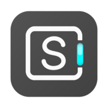
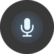
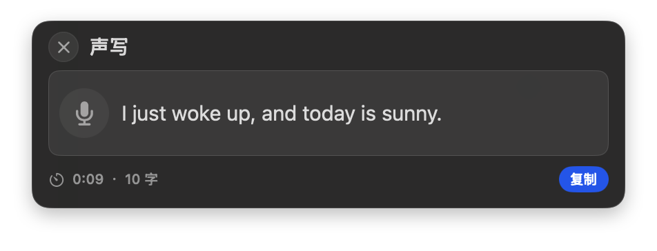
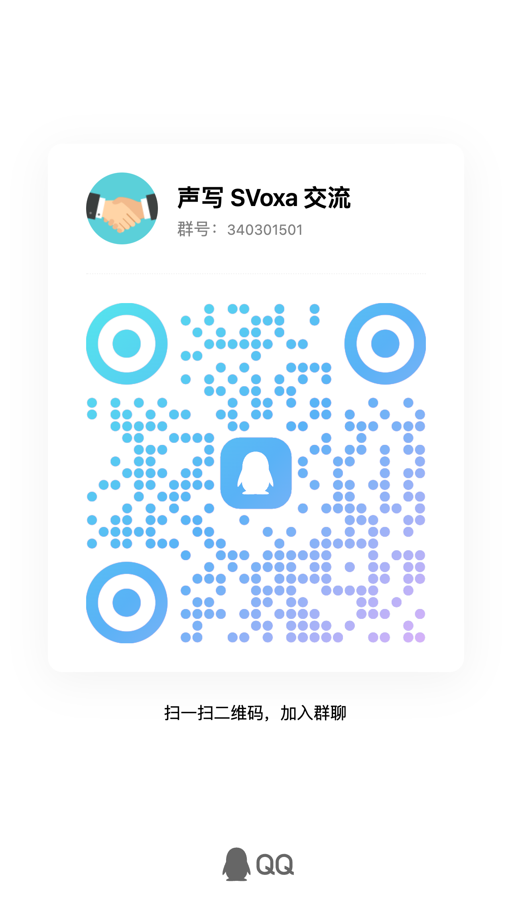

  

<h1 align="center">声写 SVoxa</h1>

<strong>专为 Mac 打造，让表达从开口开始。</strong>

本地语音输入 · AI 润色 · 音视频转写 更轻松地回复消息、撰写邮件、整理想法。

  
  
  

<strong>Mac App Store 免费下载</strong> 
  <a href="https://apps.apple.com/cn/app/svoxa/id6782120333">中国大陆商店</a> ·
  <a href="https://apps.apple.com/us/app/svoxa-voice-to-text/id6782120333">美国商店（英文）</a>

  <a href="#加入声写交流群">QQ 交流群</a> · <a href="#邀请体验与测评">测评合作</a> · <a href="输入助手安装.md">输入助手下载</a> · <a href="快速上手.md">快速上手</a> · <a href="https://github.com/miobook/SVoxa/issues">问题反馈</a> · <a href="https://svoxa.app/zh-hans/">官网</a>

 

  

<strong>完整文字，随时查看。精简电平，轻巧陪伴。</strong>

  　
  

---

## 说出想法，从短句到长段表达

回消息、写邮件、给 AI 描述需求——短句可以按住听写键说，松开结束；长段表达可以使用 Pro 免按听写，不必一直按键。

完整浮窗让你边说边看文字，适合梳理文章提纲、说明背景与要求。识别后检查文字，再复制或交付到目标输入框。

不需要一直看完整文字时，可以切换到精简电平模式。结束后预览并复制结果，让界面少占一点空间。

查看菜单与功能入口

 

## AI 润色，让文字贴近你的用途 · Pro

想把口述内容整理成邮件、调整表达语气，或翻译为另一种语言？主动开启并配置 AI 润色后，可以使用内置示例，也可以写下自己的要求，为不同场景保存方案。

例如，将听写原文“我刚起床，今天晴天。”翻译为英文：

你可以自选服务与模型。AI 润色会把听写文字与要求发送给所选服务，不发送音频；服务商可能另行收费，费用不包含在 Pro 中。处理后的文字仍需检查。

## 整理音视频，留下可用的文字 · Pro

把已有的会议录音、采访或视频在 Mac 本机转成文字，省去反复播放、逐句记录的步骤。完成后查看结果，复制正文，或导出 **TXT 文本、SRT／VTT 字幕**。

转写后检查人名、术语与数字，再用于文稿或字幕整理。

## 从一次真实输入开始

下载主程序，按引导完成麦克风授权。按住当前设置的听写键说话，松开结束，检查并复制识别结果。

## 输入助手：说完，直接进入文本框

安装可选的 SVoxa 输入助手，在主程序中开启“自动输入”，就能把听写结果交付到当前可编辑文本框。自动输入不是 Pro 专享；不安装助手也可以听写后手动复制。

**[下载输入助手 1.0.0（25）· DMG](https://download.svoxa.app/input-assistant/releases/1.0.0-25/SVoxa-Input-Assistant-1.0.0-25.dmg)** · [安装与授权说明](输入助手安装.md)

已经安装该版本无需重复安装。部分受保护或自绘文本区域不支持自动输入。

## 适用设备

Apple Silicon Mac，macOS 13 或更高版本；暂不支持 Intel Mac。

## 免费与 Pro

免费版可使用长按听写和本地识别，支持最多 20 个自定义词。

Pro 包含免按听写、AI 润色、音视频文件转写、保存听写记录、无限自定义词汇及词库导入导出。年度订阅和一次性终身购买的 Pro 功能相同。

实际价格与试用资格以 App Store 显示为准。年度订阅自动续订，除非取消；购买终身版不会自动取消已有年度订阅。

## 本地处理与可选 AI

语音识别和音视频文件转写在 Mac 本机完成。可选 AI 润色需要自行配置并开启，仅向所选服务发送听写文字与润色要求，不发送音频。服务商可能另行收费，不包含在 SVoxa 权益中。

## 邀请体验与测评

如果你关注 Mac 效率工具、AI 应用或创作工作流，欢迎体验声写 SVoxa，分享你的真实使用感受。

我们期待看到它在真实任务中的表现：口述一封邮件、向 AI 讲清需求、整理采访录音，或比较完整浮窗与精简电平模式。好用的地方、遇到的限制和改进建议，都欢迎如实表达。

**博主、视频创作者与媒体朋友**：如需沟通测评安排、产品资料或 Pro 功能体验，请联系 [support@svoxa.app](mailto:support@svoxa.app)，附上你的主页链接、希望体验的场景及大致时间。具体支持方式沟通确认，不要求正面评价。

## 加入声写交流群

交流使用心得、分享 AI 润色方案，也告诉我们哪些地方还不够顺手。

**QQ 群：声写 SVoxa 交流 · `340301501`**

[点击加入 QQ 群](https://qm.qq.com/q/KLsTjZtWs8)

用手机 QQ 扫描下方二维码，或搜索群号 **340301501**。点击图片可查看原图。

邀请链接未打开时，可在 QQ 中搜索群号。问题也可以通过 GitHub Issues 或邮件反馈，无需加群。请勿在群内分享私人正文、录音、密钥或支付凭据。

## 获取帮助与反馈

[快速上手](快速上手.md) · [常见问题](常见问题.md) · [反馈问题或建议](https://github.com/miobook/SVoxa/issues) · [邮件联系](mailto:support@svoxa.app)

商店链接没有定位到应用时，可在 Mac App Store 搜索 **SVoxa**，应用 ID 为 `6782120333`；下载以 Apple 账户所在地区的商店可用性为准。[查看下载说明](快速上手.md)

反馈请提供版本、使用场景与复现步骤。Issues 公开可见，请勿提交私人正文、录音、密钥或支付凭据。[反馈须知](CONTRIBUTING.md)

本仓库提供产品介绍与用户支持，不包含 App 源代码，软件并非通过此仓库开源。退款与订阅事务请通过 Apple 办理。

---

<strong>下一条消息，试着说出来。</strong>

<a href="https://apps.apple.com/cn/app/svoxa/id6782120333">中国大陆商店</a> · <a href="https://apps.apple.com/us/app/svoxa-voice-to-text/id6782120333">美国商店（英文）</a>

